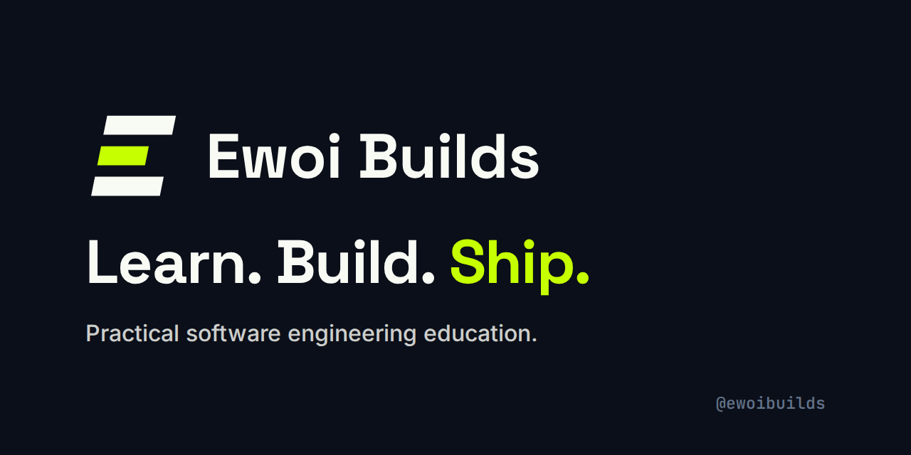

# Ewoi Builds

**Tutorials teach syntax. Projects teach you to build software.**

Every repo here is a step toward a real, full project that you build yourself and keep on your
own GitHub: practical software engineering, free, from your first commit to a deployed app.

## How to use these repos

1. Pick a learning path repo and start at `step-01`.
2. Build each step yourself, then compare with the next step's code when you get stuck.
3. Commit as you go. By the last step you have a complete full-stack project of your own.

Each repo's README lists what you need (computer, tools and versions), the Git setup, and the
lesson for every step. Learning path repos appear here as each path launches.

## Follow along

- YouTube: [@ewoibuilds](https://www.youtube.com/@ewoibuilds) for full walkthroughs; subscribe for the next one
- TikTok: [@ewoibuilds](https://www.tiktok.com/@ewoibuilds)
- Instagram: [@ewoibuilds](https://www.instagram.com/ewoibuilds/)
- Facebook: [Ewoi Builds](https://www.facebook.com/profile.php?id=61596671420317)

## Support free learning

Star the repos that help you, follow the organisation for new projects, and share a lesson with a
friend who is learning. Every lesson stays free; if one helped you, you can say thanks with a
[soda (M-Pesa)](https://buymesoda.com/Rd3JwfQpNGaUXdyc4ImyIrXrENu2) or a [coffee](https://buymeacoffee.com/ewoibuilds).

**Learn. Build. Ship.**
